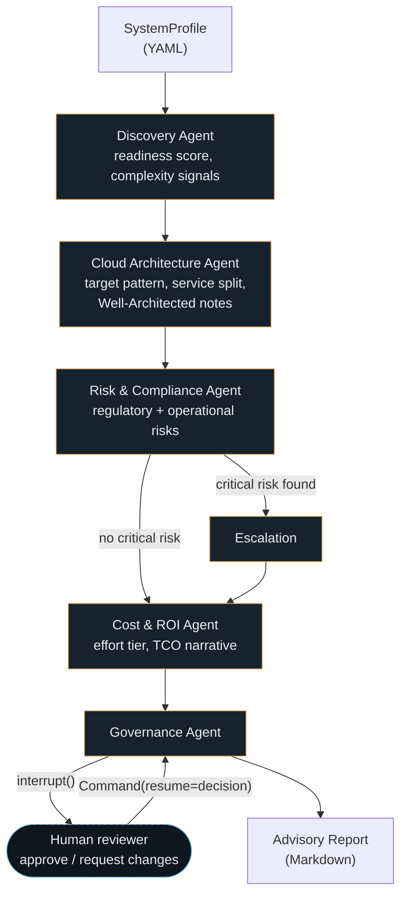

# Wayfinder

**An agentic AI advisor for cloud migration & digital transformation planning — with a human governance gate that isn't decorative.**

Wayfinder takes a structured description of a legacy system and runs it through five specialized agents — orchestrated as a [LangGraph](https://github.com/langchain-ai/langgraph) state graph — to produce a migration roadmap: readiness score, target architecture, regulatory risk register, cost/effort sizing, and a phased plan. The graph then **pauses and waits for an explicit human approve/reject decision** before the report is finalized. Nothing ships without a named reviewer.

```
$ wayfinder run examples/legacy_trading_platform.yaml --auto-approve
──────────── Wayfinder — assessing Core Trading Ledger ────────────
  done discovery
  done architecture
  done risk
  done cost

# Migration & Transformation Roadmap: Core Trading Ledger

> Core Trading Ledger scores 5/100 on migration readiness. Recommended
> approach: refactor to AWS (primary) with IBM Cloud for the
> data-residency-constrained region(s), sized as a XL-tier programme
> (~14 months), with 4 risk(s) identified (1 critical). Projected
> post-migration efficiency gain: 45%.
```

Runs immediately, offline, with no API key — see [Why it works with zero setup](#why-it-works-with-zero-setup).

---

## Why this exists

Two things are true about enterprise architecture in 2026: agentic AI has become the top investment priority for EA leaders, and almost none of the public demos of "AI agents for X" would survive contact with a real architecture review board — no audit trail, no human sign-off, no way to tell whether a recommendation came from a real analysis or a plausible-sounding hallucination.

Wayfinder is a small, honest attempt at the alternative: an agent system where

- every analytical decision (readiness score, risk severity, cost tier) is produced by a **named, inspectable heuristic function** — you can read exactly why the tool said what it said, in plain Python, not by reverse-engineering a prompt;
- an LLM is used for exactly one thing — turning that structured analysis into readable prose — and is fully swappable, including for **no LLM at all**;
- the workflow has a **real human-in-the-loop gate**, implemented with LangGraph's `interrupt()`/`Command(resume=...)` mechanism, not a `print("please approve")` that nothing downstream actually respects.

It's deliberately scoped as a planning/advisory tool, not an auto-pilot that touches infrastructure. The output is a document a migration governance board could plausibly review, not a set of API calls that changes anything by itself.

## Architecture



Every agent is a pure function `(SystemProfile, ...prior findings) -> TypedFinding` — see [`src/wayfinder/agents/`](src/wayfinder/agents/). The graph in [`src/wayfinder/graph.py`](src/wayfinder/graph.py) only wires them together and owns the one piece of real control flow: routing to an escalation step when the risk agent finds a `CRITICAL` finding, and halting for human approval before the report is built.

## Why it works with zero setup

Most agentic AI demos require an API key before you can see anything happen. Wayfinder's agents separate **analysis** (deterministic, heuristic, always-on) from **narration** (the prose summaries, LLM-generated when you want them to be):

| | Analysis (scores, risks, cost tier) | Narration (prose summaries) |
|---|---|---|
| Default | Rule-based, in `agents/*.py`, fully tested | `MockNarrator` — deterministic templating, no network |
| Optional | *(never LLM-driven — this is the part that must be trustworthy)* | `AnthropicNarrator` — real model, same interface |

Set `WAYFINDER_LLM_PROVIDER=anthropic` and `ANTHROPIC_API_KEY` (see [`.env.example`](.env.example)) to get LLM-written narrative summaries. Leave it unset and every example below runs exactly as shown, on a clean checkout, in under a second.

## Quickstart

```bash
git clone <this-repo>
cd wayfinder-migration-advisor
python -m venv .venv && .venv/Scripts/activate   # or source .venv/bin/activate on macOS/Linux
pip install -e .

wayfinder run examples/legacy_trading_platform.yaml
```

You'll be dropped into the governance gate interactively:

```
╭─── Governance gate -- human approval required ───╮
│ Core Trading Ledger                               │
│ Readiness: 5/100  |  Pattern: refactor  |  ...     │
│ Critical risks: [PCI DSS] cardholder data...       │
│                                                     │
│ Approve this migration roadmap for release?        │
│ Respond 'approved' or 'changes_requested'.         │
╰─────────────────────────────────────────────────╯
approve / reject >
```

Non-interactive use (CI, demos, scripting):

```bash
wayfinder run examples/legacy_trading_platform.yaml --auto-approve --out report.md
wayfinder run examples/legacy_trading_platform.yaml --reject "Need a DR plan before sign-off" --out report.md
```

Try the second example to see the tool discriminate correctly between a high-risk system and a low-risk one:

```bash
wayfinder run examples/retail_order_platform.yaml --auto-approve
# readiness 82/100, replatform, single-cloud -- vs. 5/100, refactor, dual-cloud above
```

### Describing your own system

Copy [`examples/legacy_trading_platform.yaml`](examples/legacy_trading_platform.yaml) and edit the fields — `current_stack`, `scale`, `constraints.regulatory` (matched against the knowledge base in [`agents/risk_compliance.py`](src/wayfinder/agents/risk_compliance.py): `GDPR`, `PCI DSS`, `MiFID II`, `SOX`), and `business_drivers`.

## Design choices worth arguing with

- **Typed state, not prompt soup.** Every value that crosses an agent boundary is a Pydantic model (`src/wayfinder/models.py`). Agents cannot silently pass malformed data to each other; the graph's edges are the same TypedDict LangGraph checkpoints, so a `pytest` run catches breakage that a print-and-pray prompt chain wouldn't.
- **The escalation path is a real conditional edge**, not a comment. A `CRITICAL` risk finding changes the graph's execution path (`risk -> escalation -> cost` instead of `risk -> cost`) and that fact is carried into the final report and the governance prompt.
- **The governance interrupt survives a process restart.** Because the graph is compiled with a `checkpointer`, the paused run's state lives outside the Python process. In this repo that's an in-memory `MemorySaver` for simplicity; swapping in a persistent backend (Postgres, Redis) is a one-line change and would let a real reviewer approve a run hours later, from a different machine.
- **No agent can see raw text from another agent** — only its typed finding. This is a deliberate constraint against prompt-injection-by-chaining: a compromised or hallucinating upstream agent can produce a wrong *structured* finding, but it can't smuggle new instructions into a downstream agent's prompt, because downstream prompts are built from typed fields, not concatenated free text.

## Project structure

```
src/wayfinder/
  models.py              typed domain model (SystemProfile, findings, report)
  llm.py                 pluggable narrator (MockNarrator / AnthropicNarrator)
  agents/
    discovery.py          readiness scoring
    cloud_architecture.py target platform, migration pattern, service split
    risk_compliance.py    regulatory + operational risk register
    cost_roi.py            effort sizing, TCO narrative
    governance.py          report synthesis + the human approval contract
  graph.py                LangGraph wiring, conditional routing, checkpointing
  report.py               Markdown rendering
  cli.py                  `wayfinder run ...`
examples/                 two contrasting SystemProfile YAML files
tests/test_graph.py       end-to-end graph tests, fully offline
```

## Testing

```bash
pytest tests/ -v
```

Six tests, all offline (`MockNarrator`, no network): the graph runs end-to-end, a PCI-DSS profile correctly escalates and a low-risk one doesn't, a rejection at the governance gate is recorded with its reviewer note, readiness scoring correctly ranks a legacy stack below a modern one, and both example YAML files validate against the schema.

## Honest limitations

This is a portfolio-grade reference implementation, not a production migration-planning product. In particular: the risk knowledge base covers four regulations as a demonstration, not a compliance catalogue; the service-decomposition heuristic is a deliberately naive starting hypothesis (the report says so); and `MemorySaver` means a paused approval doesn't survive a process restart out of the box. All three are described here rather than hidden, because that's the same standard the tool applies to its own output.

## License

MIT — see [LICENSE](LICENSE).

---

Built by [Samir Kumar Sahoo](https://www.linkedin.com/in/samirksahoo/), Principal Architect focused on Agentic AI governance, cloud-native architecture, and digital transformation in banking & financial services.
